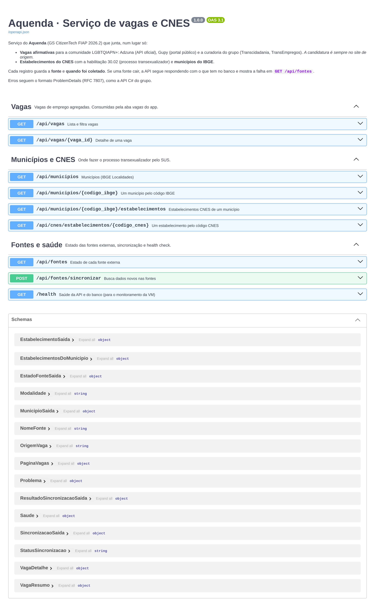
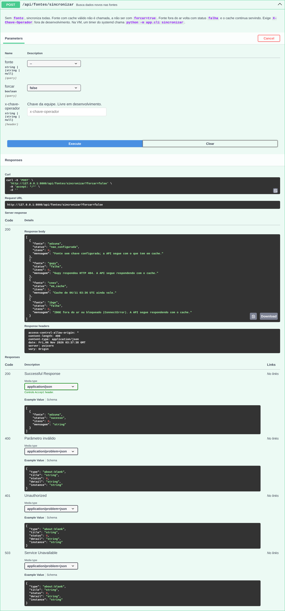
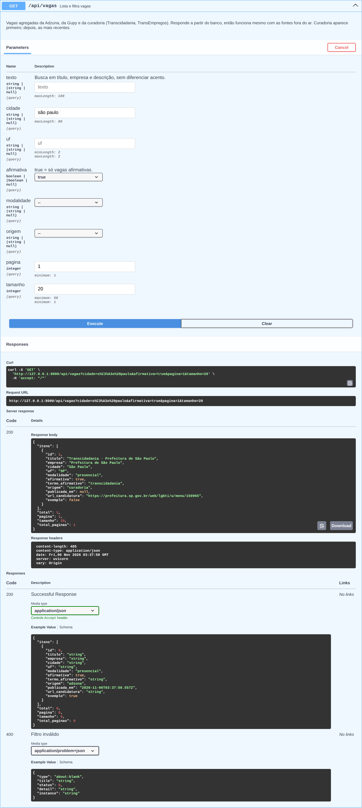
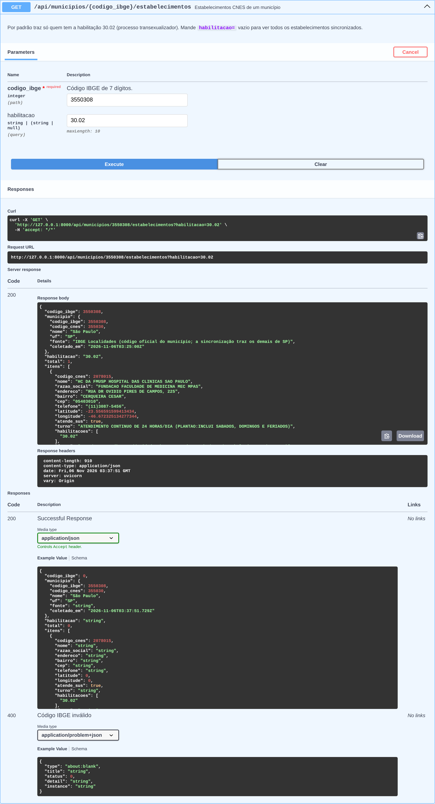
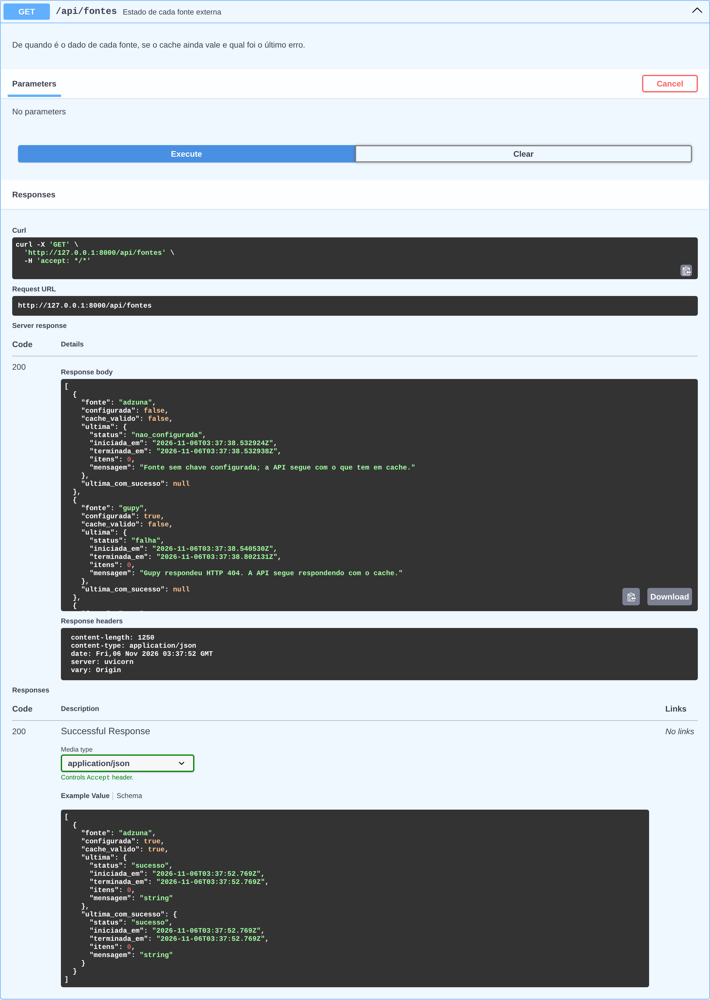

# Aquenda · Serviço FastAPI (SOA e Web Services)

Serviço do **Aquenda**, a CitizenTech do grupo na Global Solution FIAP 2026.2 (Engenharia de Software, 3º ano).
Esta é a entrega de **Arquitetura Orientada a Serviços (SOA) e Web Services**: o serviço em Python que agrega **vagas de emprego afirmativas** e sincroniza os **estabelecimentos do CNES** (processo transexualizador) e os **municípios do IBGE**, guardando a fonte e a data de cada registro.

## Ficha da CitizenTech

| Campo | Conteúdo |
|---|---|
| Nome | Aquenda |
| Cidade e bairro | São Paulo, com foco no Centro (República, Arouche) e nas regiões dos Centros de Referência LGBTI+ |
| Cidadão beneficiado | Pessoa LGBTQIAPN+ em São Paulo, principalmente trans, travesti ou em vulnerabilidade social |
| Problema, em uma frase | Os serviços de acolhimento, saúde, defesa e trabalho existem, mas estão espalhados, e quem precisa não sabe onde fica o mais próximo nem se será bem atendide |
| Como funciona | App que mostra serviços perto da pessoa (acolhimento, saúde trans, jurídico), vagas afirmativas, salas de conversa moderadas e rolês LGBT+, com agenda de hormônio guardada só no celular |
| O que cada parte faz | App Expo (porta de entrada) · API C# (catálogo, rodas, vagas das casas) · **FastAPI (vagas de emprego e sync CNES)** · ESP32 (ocupação das casas) · ML (desertos de cuidado) · VM Linux (hospedagem) · módulo PII (segurança) |
| Link do repositório | https://github.com/Lynnbrosa/GS-SOA-AQUENDA (API C#: https://github.com/Lynnbrosa/GS-c--AQUENDA) |
| Indicador de impacto | Buscas que terminam em "como chegar" ou "ligar" e tempo até achar um serviço, medidos sem guardar quem buscou |
| ODS conectados | 10 Redução das desigualdades · 3 Saúde e bem-estar · 11 Cidades e comunidades sustentáveis |

**Integrantes:**

| Nome | RM |
|---|---|
| Giovanne Charelli Zaniboni Silva | 556223 |
| Gustavo Oliveira de Moura | 555827 |
| Lynn Bueno Rosa | 551102 |

O nome vem do pajubá, a linguagem criada e mantida pela comunidade travesti: *aquenda* é prestar atenção, olhar por alguém.

## O que o serviço faz

- **Vagas afirmativas** (`/api/vagas`): junta a **Adzuna** (API oficial), a **Gupy** (endpoint público do portal de vagas) e a **curadoria do grupo** (Transcidadania e TransEmpregos, fixos e com fonte). Filtra por texto, cidade, UF, afirmativa, modalidade e origem. Cada vaga diz **por que** é afirmativa (o trecho do anúncio) e traz o link do **site de origem**: a candidatura é sempre lá, o Aquenda não recebe currículo.
- **Saúde trans no SUS** (`/api/municipios/{codigo}/estabelecimentos`): estabelecimentos do **CNES** com a habilitação **30.02** (processo transexualizador), com endereço, telefone, coordenadas e data de atualização no CNES.
- **Municípios** (`/api/municipios`): base do **IBGE Localidades**, com o código que o DATASUS usa (IBGE sem o dígito verificador).
- **Fontes** (`/api/fontes`): de quando é o dado de cada fonte, se o cache vale e qual foi o último erro. `POST /api/fontes/sincronizar` busca dados novos.

**Se uma fonte cair, o serviço continua respondendo.** As rotas de leitura só leem o banco. A sincronização registra a falha e não apaga nada. Vaga que sumiu da fonte só sai da listagem depois de uma coleta que funcionou e trouxe resultado.

## Como rodar

Pré-requisito: Python 3.11 ou mais novo.

```bash
python -m venv .venv && . .venv/bin/activate
```

```bash
pip install -r requirements.txt && alembic upgrade head
```

```bash
uvicorn app.main:app --port 8000
```

Abre em http://localhost:8000/docs (Swagger) e http://localhost:8000/redoc. Sem `DATABASE_URL`, o banco é `./aquenda_soa.db`. A base já nasce com a curadoria, o município de São Paulo e o HC-FMUSP (retrato do CNES de 06/11/2026), então o app tem resposta antes da primeira sincronização.

Buscar dados novos (pela API ou pela linha de comando):

```bash
curl -X POST "http://localhost:8000/api/fontes/sincronizar"
```

```bash
python -m app.cli sincronizar --fonte cnes --forcar
```

Testes (não usam a rede):

```bash
pytest
```

### Variáveis de ambiente

Copie `.env.example` para `.env`. O `.env` não vai para o repositório.

| Variável | Para quê | Padrão |
|---|---|---|
| `DATABASE_URL` | Banco (SQLite ou PostgreSQL) | `sqlite:///./aquenda_soa.db` |
| `ADZUNA_APP_ID`, `ADZUNA_APP_KEY` | Chave grátis em developer.adzuna.com. Sem ela, a Adzuna fica `nao_configurada` e o resto funciona | vazio |
| `CHAVE_OPERADOR` | Protege `POST /api/fontes/sincronizar` (cabeçalho `X-Chave-Operador`) | vazio |
| `AMBIENTE` | Em `desenvolvimento`, a sincronização fica livre sem chave. Fora dele, sem chave configurada responde 503 | `desenvolvimento` |
| `GUPY_URL` | Endpoint público da Gupy (configurável porque não é API oficial) | `https://portal.api.gupy.io/api/job` |
| `CACHE_MINUTOS_VAGAS`, `CACHE_MINUTOS_CNES`, `CACHE_MINUTOS_IBGE` | Quanto tempo o resultado de cada fonte vale | 60 · 1440 · 10080 |
| `MIGRAR_AO_INICIAR` | Aplica as migrações na subida | `true` |

### Publicar na VM (contrato do grupo)

```bash
pip install -r requirements.txt && alembic upgrade head
```

| Item | Valor na VM |
|---|---|
| Porta | 8000 |
| `DATABASE_URL` | por exemplo `sqlite:////var/lib/aquenda/soa.db` (a pasta é criada se não existir) |
| `ADZUNA_APP_ID`, `ADZUNA_APP_KEY`, `CHAVE_OPERADOR` | segredos da equipe, fora do repositório |
| `AMBIENTE` | `producao` |

Saúde do serviço para o monitoramento: `GET /health`. Exemplos de unidade systemd em [`docs/deploy/`](docs/deploy/): o serviço (`aquenda-soa.service`) e um timer que sincroniza de hora em hora (`aquenda-soa-sync.timer`). O comando `python -m app.cli sincronizar` sai com código 1 se alguma fonte falhou, para o monitoramento registrar.

## Endpoints

| Método | Rota | O que faz |
|---|---|---|
| GET | `/api/vagas` | Lista e filtra (`texto`, `cidade`, `uf`, `afirmativa`, `modalidade`, `origem`, `pagina`, `tamanho`) |
| GET | `/api/vagas/{id}` | Detalhe com descrição, fonte, data da coleta e aviso de candidatura no site de origem |
| GET | `/api/municipios?uf=SP&nome=` | Municípios do IBGE, busca sem diferenciar acento |
| GET | `/api/municipios/{codigo_ibge}` | Um município |
| GET | `/api/municipios/{codigo_ibge}/estabelecimentos?habilitacao=30.02` | Estabelecimentos CNES do município (por padrão, só os com habilitação 30.02) |
| GET | `/api/cnes/estabelecimentos/{codigo_cnes}` | Um estabelecimento |
| GET | `/api/fontes` | Estado de cada fonte: configurada, cache válido, última coleta e última coleta boa |
| POST | `/api/fontes/sincronizar?fonte=&forcar=` | Busca dados novos (todas ou uma fonte) |
| GET | `/health` | Saúde do serviço e do banco |

Erros voltam como ProblemDetails (RFC 7807), igual à API C#: 400 para parâmetro inválido, 404 para recurso inexistente, 422 para regra de negócio, 401/503 para a chave de operador.

Exemplo para o app (vagas afirmativas em São Paulo):

```bash
curl "http://localhost:8000/api/vagas?afirmativa=true&cidade=sao%20paulo"
```

## Arquitetura

Mesma organização em camadas da API C#. As dependências apontam para dentro: a API conhece a aplicação, a aplicação conhece o domínio, e o domínio não conhece ninguém (nem FastAPI, nem SQLAlchemy, nem httpx).

```
app/
  domain/           entidades e regras: Vaga, Municipio, EstabelecimentoCnes, Sincronizacao,
                    regra de vaga afirmativa, regra de cache, contratos dos repositórios
  application/      casos de uso: consultas (vagas, municípios, CNES) e sincronização;
                    portas para as fontes externas (FonteDeVagas, FonteCnes, FonteIbge)
  infrastructure/
    db/             modelos SQLAlchemy, sessão a partir de DATABASE_URL, migrações por código
    repositorios/   repositórios SQL e unidade de trabalho (um commit por caso de uso)
    fontes/         adaptadores HTTP: Adzuna, Gupy, CNES, IBGE
  api/              rotas FastAPI, schemas Pydantic, dependências, ProblemDetails
  cli.py            sincronização pela linha de comando (timer da VM)
alembic/            env.py (lê DATABASE_URL) e versions/
tests/              87 testes pytest + respostas gravadas em tests/fixtures
```

```
app Expo ──► FastAPI (porta 8000) ──► banco (DATABASE_URL)
                    │                      ▲
                    └── sincronização ─────┘
                          ├─ Adzuna   (API oficial, chave)
                          ├─ Gupy     (portal público, cache de 60 min)
                          ├─ CNES     (apidadosabertos.saude.gov.br)
                          └─ IBGE     (servicodados.ibge.gov.br)
```

## Onde cada critério da rubrica aparece

| Critério | Peso | Onde ver |
|---|---|---|
| **Estruturação do domínio** | 3,0 | `app/domain`. `Vaga.criar` é a única porta de entrada: limpa HTML, recusa link que não é http(s) (ex.: `javascript:`), corrige salário invertido e decide se a vaga é afirmativa. A regra de vaga afirmativa (`domain/afirmativa.py`) usa fronteira de palavra para não confundir "trans" com "transporte" e guarda o termo encontrado. `Municipio` confere a UF pelo código IBGE; `codigo_municipio_cnes` converte para o código de 6 dígitos do DATASUS. `EstabelecimentoCnes` não guarda e-mail e preserva as habilitações da curadoria quando o CNES atualiza. `cache_valido` e `Sincronizacao` decidem quando chamar uma fonte. Repositórios e fontes são contratos (`Protocol`) que a infraestrutura implementa; a aplicação recebe tudo por injeção (`app/api/deps.py`). |
| **Conexão com banco de dados** | 3,0 | `app/infrastructure/db`: engine a partir de `DATABASE_URL` (SQLite com WAL e chaves estrangeiras; PostgreSQL funciona sem mudar código). Tipo `UtcDateTime` grava UTC e devolve com fuso. Repositórios em `repositorios/sql.py` com filtros no SQL (`LIKE` com escape, colunas normalizadas sem acento, paginação, contagem), *upsert* pela chave natural `(origem, id_externo)` e desativação em lote de vagas que saíram da fonte. Unidade de trabalho com um commit por caso de uso e rollback quando a fonte falha. |
| **Migrações** | 1,5 | Alembic em `alembic/`. `0001` cria as 5 tabelas com índices e restrições únicas. `0002` é uma **migração de dados**: curadoria (Transcidadania, TransEmpregos), lista de habilitação 30.02 e retrato do CNES, com `downgrade` que desfaz. `render_as_batch` para o SQLite. Testes sobem e descem as migrações e comparam com os modelos (`alembic check` também roda no CI). |
| **Documentação automática** | 1,5 | Swagger em `/docs` e ReDoc em `/redoc`, com descrição do serviço, 3 grupos de rotas, resumo e descrição por endpoint, exemplos nos parâmetros, descrição dos campos nos schemas e respostas de erro documentadas como `application/problem+json` (o 422 padrão do FastAPI foi trocado pelo 400 que a API realmente devolve). |
| **Testes automatizados** | 1,0 | 87 testes pytest: domínio (regras), adaptadores HTTP contra respostas gravadas, sincronização ponta a ponta (cache, falha, fonte vazia, vaga que saiu do ar, atualização sem duplicar), contrato HTTP (filtros, paginação, erros, chave de operador, Swagger) e migrações. A rede fica bloqueada no `conftest.py`: se um teste tentar a internet, falha. CI no GitHub Actions. |

## Fontes, cache e o que acontece quando algo cai

| Fonte | Como entra | Cache | Se falhar |
|---|---|---|---|
| Adzuna | `GET /v1/api/jobs/br/search/{página}` com `what_or` (afirmativa, LGBT, travesti...) em São Paulo, até 2 páginas | 60 min | Sem chave: `nao_configurada`. Chave recusada, fora do ar ou formato estranho: `falha`, e as vagas antigas continuam |
| Gupy | Endpoint público do portal, buscando "afirmativa", "pessoas trans" e "LGBT", sem duplicar | 60 min | `falha`; URL configurável em `GUPY_URL` |
| CNES | `GET /cnes/estabelecimentos/{código}` para cada código da lista de habilitação 30.02 | 24 h | `falha`; código que não existe mais é avisado na mensagem |
| IBGE | `GET /localidades/estados/SP/municipios` | 7 dias | `falha`; resposta vazia também conta como falha |

A API aberta do CNES não filtra por habilitação. Por isso a lista de quem tem a 30.02 fica na tabela `habilitacoes_cnes` (curadoria, com fonte e data), e a sincronização completa o resto pelo CNES. **Hoje a lista tem só o HC-FMUSP (CNES 2078015)** e está marcada para conferência. O grupo precisa confirmar os códigos na portaria de habilitação e acrescentar os ambulatórios de São Paulo com uma nova migração de dados.

## Decisões de segurança e privacidade

- **Nenhum dado de quem usa o app passa por aqui.** Não há cadastro, currículo nem registro de quem buscou o quê. A agenda de hormônio, consultas e PIN ficam só no celular (contrato do grupo).
- **E-mail do CNES não é guardado.** A resposta do CNES traz o e-mail do responsável pelo cadastro, que costuma ser pessoal; o adaptador ignora o campo e um teste garante que o estabelecimento convertido não carrega nada com `@`. A resposta gravada para os testes também está sem ele.
- **Link de candidatura só http(s).** Evita que um anúncio malicioso injete `javascript:` no app.
- **Escrita protegida.** A sincronização exige `X-Chave-Operador` fora de desenvolvimento, comparado em tempo constante.
- **Cliente HTTP identificado.** As fontes recebem o User-Agent `aquenda-soa/1.0 (GS CitizenTech FIAP)`. A Gupy é usada pelo endpoint público, com cache de 60 minutos para não sobrecarregar.

## Dados

As respostas usadas nos testes estão em [`tests/fixtures`](tests/fixtures), com a origem de cada uma no README da pasta. As do **CNES** e o 401 da **Adzuna** foram **gravadas** das APIs reais em 06/11/2026. As da Adzuna com resultados, da Gupy e do IBGE foram **montadas** no formato documentado de cada fonte (sem chave da Adzuna; a Gupy respondeu 404 e o IBGE recusou a conexão vindas do servidor de desenvolvimento), com empresas fictícias ("Empresa Exemplo").

Fontes: [CNES, dados abertos do Ministério da Saúde](https://apidadosabertos.saude.gov.br) · [IBGE Localidades](https://servicodados.ibge.gov.br/api/docs/localidades) · [Adzuna API](https://developer.adzuna.com) · [Prefeitura SP, Transcidadania](https://prefeitura.sp.gov.br/web/lgbti/w/menu/150965) · [TransEmpregos](https://www.transempregos.org) · [Portaria de habilitação citada no pitch](https://www.conass.org.br/?p=2674)

## Evidências

Swagger com todos os endpoints:



Sincronização com fontes fora do ar: Gupy e IBGE em `falha`, CNES servido do cache, Adzuna sem chave. A API seguiu respondendo:



Vagas afirmativas em São Paulo:



Estabelecimentos com habilitação 30.02 no município de São Paulo:



Estado das fontes:


